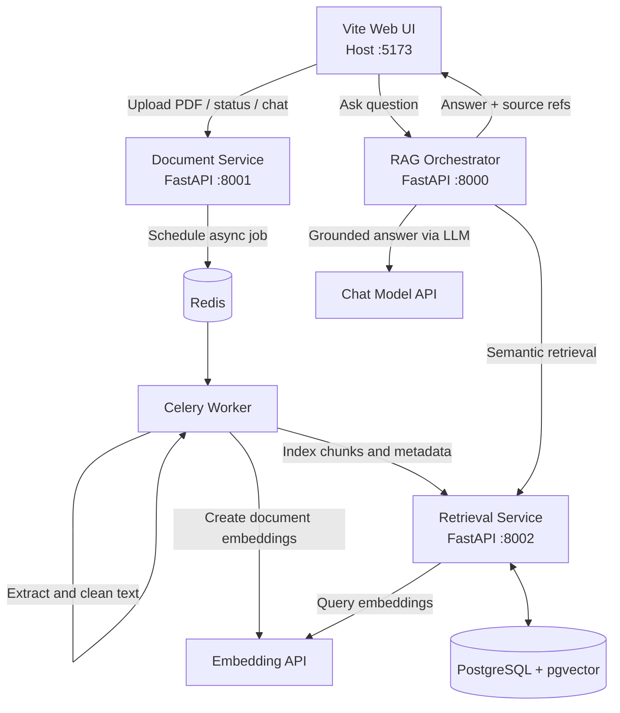

# Multi-Service Persian RAG System

A local, Dockerized Retrieval-Augmented Generation system for Persian PDF documents. The project separates document ingestion, vector indexing, and answer generation into three FastAPI services, with a host-run Vite frontend for interaction.

This repository is implemented as a development-oriented stack rather than a production deployment. It is designed to run locally with Docker Compose, PostgreSQL + pgvector, Redis, Celery, and an external OpenAI-compatible embedding/chat provider.

## Architecture

| Component | Role | Local endpoint / access |
|---|---|---|
| `rag-service` | FastAPI orchestrator; runs the LangGraph RAG workflow and returns grounded answers | `http://127.0.0.1:8000` |
| `document-service` | Uploads PDFs, stores metadata, manages chat history, and schedules async processing | `http://127.0.0.1:8001` |
| `retrieval-service` | Creates embeddings for query text and stores/indexes chunk vectors in PostgreSQL using pgvector | `http://127.0.0.1:8002` |
| `celery-worker` | Asynchronous PDF extraction, text cleaning, chunking, embedding, and indexing job runner | internal Docker network |
| `postgres` | PostgreSQL with pgvector extension; stores document metadata and chunk vectors | `127.0.0.1:5433` |
| `redis` | Celery broker and result backend | `127.0.0.1:6379` |
| `frontend` | Vite-based Persian web UI | `http://127.0.0.1:5173` |

### Service communication

The backend containers communicate over Docker Compose networking using service names, not `localhost`:

- `rag-service` → `http://retrieval-service:8002`
- `document-service` / `celery-worker` → `http://retrieval-service:8002`
- `document-service` / `celery-worker` → `redis://redis:6379/0`
- all backend services → PostgreSQL at `postgres:5432`

The published ports are bound to `127.0.0.1`, so the APIs are exposed on the local machine rather than on all interfaces.

### Architecture diagram



## Real flow in this codebase

### 1) Document upload and ingestion

1. The frontend uploads a PDF to `POST /documents/upload/`.
2. The `document-service` saves the original file under a document-specific storage directory.
3. The service records metadata in PostgreSQL (`documents` table), creates a chat record, and schedules a Celery task.
4. The Celery worker runs `process_document_task`.
5. The worker:
   - validates the PDF signature and structure,
   - extracts text with PyMuPDF,
   - normalizes Persian text,
   - splits the text into chunks with overlap,
   - requests embeddings from the configured embedding endpoint,
   - sends `IndexRequest` payloads to `POST /internal/index/` on the retrieval service.
6. The retrieval service writes chunk vectors and metadata into the `chunks` table using `pgvector`.
7. The document status changes to `completed` or `failed` depending on the result.

### 2) Retrieval and semantic search

The retrieval service exposes:

- `POST /search/` for vector search
- `GET /documents/{document_id}/chunks/` for retrieving chunks by document
- `POST /internal/index/` for indexing a document's chunks
- `DELETE /internal/documents/{document_id}/chunks/` for deletion cleanup

The search implementation uses cosine distance, then returns results ordered by highest similarity. For each query, the retrieval service creates an embedding via the configured embedding API and performs vector search against the `chunks` table.

### 3) Question answering via LangGraph

The `rag-service` includes a LangGraph workflow with these stages:

1. `query_processing`
2. `retrieval`
3. `context_evaluation`
4. `answer_generation`
5. `response_formatting`

The implemented flow is:

- The API receives `POST /rag/ask/` with a question and optional `document_ids` and `top_k`.
- The query is normalized.
- The system calls the retrieval service for top-k relevant chunks.
- A second LLM call evaluates whether the retrieved context is sufficient.
- If valid, the answer is generated strictly from the retrieved context.
- The response includes the answer, source references, and an `insufficient_context` flag.

This matches the README's conceptual RAG flow, but the actual implementation is more explicit than the diagram.

## What is implemented in the repo

The repository contains the following concrete structure:

```text
.
├── Dockerfile
├── docker-compose.yml
├── README.md
├── .env.example
├── SQL/
│   └── DB.sql
├── frontend/
│   ├── index.html
│   ├── package.json
│   ├── src/
│   └── vite.config.js
├── scripts/
│   └── init_db.py
├── services/
│   ├── document_service/
│   │   ├── app/
│   │   └── requirements.txt
│   ├── rag_service/
│   │   ├── app/
│   │   └── requirements.txt
│   └── retrieval_service/
│       ├── app/
│       └── requirements.txt
├── shared/
│   ├── schemas/
│   └── clients/
├── tests/
│   └── unit/
├── pytest.ini
└── .gitignore
```

## Stack and libraries

- Language: Python, JavaScript (frontend), HTML/CSS
- Runtime: FastAPI + Celery + LangGraph + SQLAlchemy + pgvector
- Main libraries:
  - `fastapi`
  - `sqlalchemy[asyncio]`
  - `pgvector`
  - `celery[redis]`
  - `langgraph`
  - `pymupdf`
  - `openai`
  - `vite`

## Requirements

- Docker Desktop / Docker Engine with Compose
- Python 3.12 for backend local debugging
- Node.js 20+ and npm for the frontend
- An OpenAI-compatible chat endpoint
- A compatible embedding endpoint whose output dimension matches the configured schema

## Configuration

From the repository root:

```powershell
if (-not (Test-Path .env)) { Copy-Item .env.example .env }
```

Then set at least:

- `POSTGRES_PASSWORD`
- `LLM_API_BASE_URL`, `LLM_API_KEY`, `LLM_MODEL`
- `EMBEDDING_API_URL`, `EMBEDDING_DIMENSION`

The example values and defaults are defined in `.env.example`.

## Run the backend

```powershell
docker compose up -d
docker compose ps
```

On the first run after updating Dockerfiles or dependencies:

```powershell
docker compose build
docker compose up -d
```

Check logs:

```powershell
docker compose logs -f
```

Stop containers without deleting volumes:

```powershell
docker compose down
```

Do not use `docker compose down -v` unless you intentionally want to remove the named volumes and all persisted data.

## Run the frontend

In a separate terminal:

```powershell
cd frontend
npm install
npm run dev
```

The frontend is a host-run Vite development server, and the UI proxies requests to the backend services on `127.0.0.1`:

- `/documents/*` → `document-service`
- `/rag/*` → `rag-service`
- `/health/*` → service health endpoints

## API overview

Swagger UI is available at:

- `http://127.0.0.1:8000/docs` — RAG Orchestrator
- `http://127.0.0.1:8001/docs` — Document Service
- `http://127.0.0.1:8002/docs` — Retrieval Service

### Document endpoints

| Method | Endpoint | Description |
|---|---|---|
| `POST` | `/documents/upload/` | Upload a PDF file |
| `GET` | `/documents/` | List documents |
| `GET` | `/documents/{document_id}/status/` | Get processing status |
| `GET` | `/documents/{document_id}/chat/` | Fetch chat history |
| `POST` | `/documents/{document_id}/chat/messages/` | Save chat messages |
| `DELETE` | `/documents/{document_id}/chat/` | Delete a document's chat history |
| `POST` | `/documents/{document_id}/reprocess/` | Requeue a document for processing |
| `DELETE` | `/documents/{document_id}/` | Delete document record, chat, and indexed chunks |

### Retrieval endpoints

| Method | Endpoint | Description |
|---|---|---|
| `POST` | `/internal/index/` | Internal chunk indexing endpoint |
| `POST` | `/search/` | Query semantic search |
| `GET` | `/documents/{document_id}/chunks/` | Fetch chunks for a document |
| `DELETE` | `/internal/documents/{document_id}/chunks/` | Delete document chunks |

### RAG endpoints

| Method | Endpoint | Description |
|---|---|---|
| `POST` | `/rag/ask/` | Ask a question and receive answer + sources |
| `GET` | `/health/` | Health check |

## Operational checks

Check container status:

```powershell
docker compose ps
```

Check health endpoints:

```powershell
Invoke-RestMethod http://localhost:8000/health/
Invoke-RestMethod http://localhost:8001/health/
Invoke-RestMethod http://localhost:8002/health/
```

Check Celery worker responsiveness:

```powershell
docker compose exec -T celery-worker celery -A services.document_service.app.tasks.celery_app.celery_app inspect ping
```

## Important current-scope notes

- PDF processing is asynchronous: upload success does not mean indexing has completed.
- Questions should only be asked after the document status becomes `completed`.
- The frontend is a lightweight local UI, not a production deployment.
- Authentication, authorization, rate limiting, hardened CORS policy, and production deployment are outside the current scope.
- The project expects external embedding and chat APIs to be available and correctly configured.
- If a PDF has no extractable text (for example, scanned image-based PDFs without OCR), it will not be processed successfully.
- Do not commit `.env`, API keys, or database credentials.

## Tests

```powershell
python -m pytest tests/unit -v
```

The test suite includes checks for PDF extraction, EmbeddingService behavior, chunk repository logic, prompt prefixing, and schema validation.

## Summary

This repository is a real multi-service RAG application for Persian PDFs, implemented as a local Docker Compose stack with a host-run frontend. The README is now aligned with the actual codebase: service boundaries, infrastructure, background ingestion flow, retrieval logic, LangGraph orchestration, and current limitations are consistent with what is implemented in the repository.

