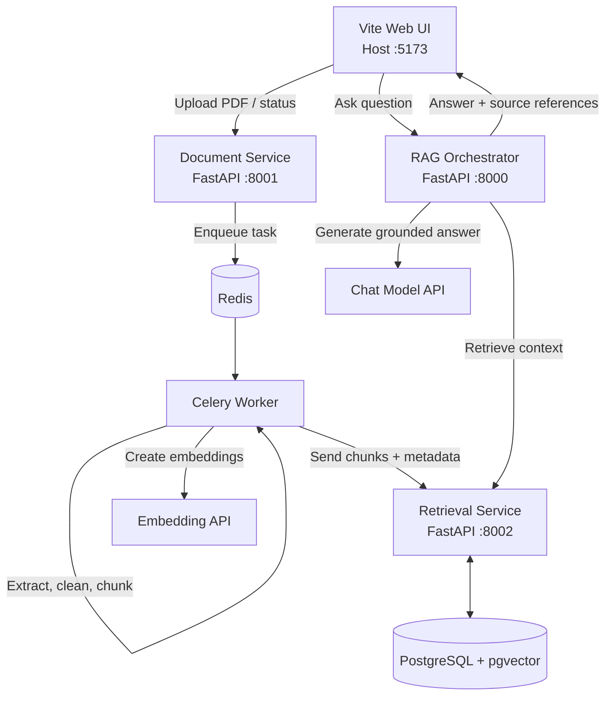
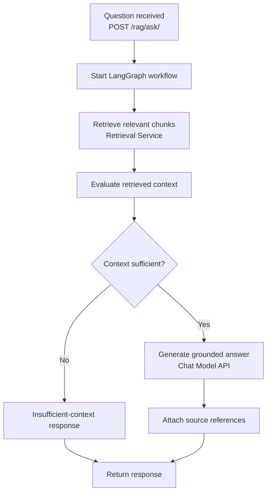

# Multi-Service Persian RAG System

A three-service Retrieval-Augmented Generation (RAG) application for uploading Persian PDF documents, processing them asynchronously, retrieving semantically relevant chunks, and answering questions with page-level source references.

The backend is containerized with Docker Compose. The Persian Vite frontend currently runs separately on the host machine.

## Architecture

| Component | Responsibility | Host address |
|---|---|---|
| RAG Orchestrator | FastAPI entry point for questions; runs the LangGraph RAG workflow | http://127.0.0.1:8000 |
| Document Service | PDF upload, metadata/status management, and document-processing coordination | http://127.0.0.1:8001 |
| Retrieval Service | Vector persistence and semantic Top-K search using pgvector | http://127.0.0.1:8002 |
| PostgreSQL + pgvector | Persistent document metadata and embedding storage | 127.0.0.1:5433 |
| Redis | Celery broker and result backend | 127.0.0.1:6379 |
| Celery Worker | Asynchronous PDF processing tasks | Internal Docker network |
| Web UI | Persian document upload, processing status, and document Q&A | http://127.0.0.1:5173 |

### Service communication

All backend containers join the Docker Compose network and communicate through Compose service names rather than `localhost`:

- RAG Orchestrator → `http://retrieval-service:8002`
- Document Service / Celery Worker → `http://retrieval-service:8002`
- Backend services → PostgreSQL at `postgres:5432`
- Document Service / Celery Worker → Redis at `redis:6379`

The published ports are bound to `127.0.0.1`, so the APIs and database are exposed on the local machine rather than on every network interface.

### Architecture diagram



### Document ingestion flow

1. The frontend uploads a PDF to the Document Service.
2. The Document Service records document metadata and dispatches an asynchronous Celery task through Redis.
3. The Celery Worker extracts text, cleans it, splits it into chunks, and requests embeddings from the configured embedding endpoint.
4. The worker sends chunks, vectors, and metadata to the Retrieval Service.
5. The Retrieval Service persists vector data in PostgreSQL using pgvector. The frontend can poll the document status endpoint while processing is in progress.

### Question answering and LangGraph flow

1. The frontend sends a question to `POST /rag/ask/`.
2. The RAG Orchestrator starts the LangGraph workflow.
3. The workflow obtains semantically relevant chunks from `POST /retrieval/search/` through the Retrieval Service.
4. Retrieved context is evaluated for relevance and sufficiency.
5. If the context is sufficient, the configured chat model generates a grounded answer with source references. If it is insufficient, the workflow returns the configured abstention / insufficient-context response instead of presenting unsupported information.

The following is a conceptual view of the workflow stages; it intentionally describes the observable RAG flow rather than prescribing internal LangGraph node names.



## Technical decisions

- **Service separation:** document ingestion, vector retrieval, and question answering are isolated behind separate FastAPI services. This keeps responsibilities clear and allows each service to be built and operated independently.
- **Asynchronous ingestion:** PDF processing is delegated to Celery so a potentially long-running extraction and embedding pipeline does not block the upload request.
- **Redis + Celery:** Redis is used as the task broker/result backend; the worker consumes background jobs independently of the API process.
- **PostgreSQL + pgvector:** relational metadata and vector embeddings are stored in PostgreSQL, avoiding a separate vector database for the current scope.
- **Docker Compose:** backend services and infrastructure run in a reproducible local container network. Compose health checks and dependency conditions gate service startup.
- **Host-run frontend:** the Vite development UI remains outside Compose and reaches the backend through the localhost-published API ports.
- **Persistent volumes:** PostgreSQL, Redis, and uploaded document storage use named volumes so normal container recreation does not erase persisted data.
- **Environment-based configuration:** secrets and environment-specific endpoints are supplied through `.env`; the real `.env` file must not be committed.

## Requirements

- Docker Desktop / Docker Engine with Docker Compose
- Node.js 20+ and npm (for the frontend)
- An OpenAI-compatible chat model endpoint
- A compatible embedding endpoint

## Configuration

From the repository root, create `.env` only if it does not already exist:

```powershell
if (-not (Test-Path .env)) { Copy-Item .env.example .env }
```

Edit `.env` and set at least:

- `POSTGRES_PASSWORD` — use a strong non-default password.
- `LLM_API_BASE_URL`, `LLM_API_KEY`, `LLM_MODEL`.
- `EMBEDDING_API_URL` and `EMBEDDING_DIMENSION`.

The embedding endpoint/model used for document and query embeddings must be compatible, and its output dimension must match the PostgreSQL vector schema. The current schema is configured for 768 dimensions.

**Important:** changing `POSTGRES_PASSWORD` in `.env` does not automatically change the password of a PostgreSQL user in an already-initialized data volume. Update the database role password deliberately if needed; do not delete the volume to solve an authentication mismatch.

## Run the backend

Start Docker Desktop, open PowerShell in the repository root, and run:

```powershell
docker compose up -d
docker compose ps
```

On the first run after changing Dockerfiles or dependencies, build the images first:

```powershell
docker compose build
docker compose up -d
```

The Compose stack contains PostgreSQL, Redis, Retrieval Service, Document Service, Celery Worker, and RAG Service.

Check service logs:

```powershell
docker compose logs -f
```

Stop the containers without deleting persistent data:

```powershell
docker compose down
```

Do **not** use `docker compose down -v` unless you intentionally want to delete the named volumes and their persisted data.

## Run the frontend

The frontend is currently a host-run Vite development server. In a separate PowerShell window:

```powershell
cd frontend
npm install
npm run dev
```

Open the URL printed by Vite (normally http://127.0.0.1:5173).

## API documentation and endpoints

Swagger UI:

- RAG Orchestrator: http://127.0.0.1:8000/docs
- Document Service: http://127.0.0.1:8001/docs
- Retrieval Service: http://127.0.0.1:8002/docs

| Method | Endpoint | Description |
|---|---|---|
| POST | `/documents/upload/` | Upload a PDF (multipart field: `file`) |
| GET | `/documents/{document_id}/status/` | Read asynchronous processing status |
| POST | `/retrieval/search/` | Semantic vector search |
| POST | `/rag/ask/` | Ask a question and receive an answer plus sources |
| GET | `/health/` | Service health check |

## Operational verification

Check all containers:

```powershell
docker compose ps
```

Check each API health endpoint:

```powershell
Invoke-RestMethod http://localhost:8000/health/
Invoke-RestMethod http://localhost:8001/health/
Invoke-RestMethod http://localhost:8002/health/
```

Check Celery worker responsiveness:

```powershell
docker compose exec -T celery-worker celery -A services.document_service.app.tasks.celery_app.celery_app inspect ping
```

A healthy API response and Celery `pong` confirm that the services respond to health checks and the worker is reachable. They do not replace an end-to-end test of PDF upload, indexing, retrieval, and answer generation.

## Local Python development (optional)

For debugging a backend service directly on Windows, stop its corresponding Compose container first to avoid a port conflict. Start PostgreSQL and Redis with Compose, then use a Python 3.12 virtual environment and install the relevant service requirements. The localhost URLs in `.env.example` are intended for host-run development; Compose overrides internal database, Redis, and inter-service URLs with Docker DNS names.

## Tests

Run unit tests from the repository root in a configured Python environment:

```powershell
python -m pytest tests/unit -v
```

Some tests may require external services or environment configuration depending on the test implementation.

## Notes and current scope

- PDF processing is asynchronous; a successful upload means the job was accepted, not that indexing has finished.
- Ask questions only after the document status becomes `completed`.
- The Web UI is a lightweight development interface, not a production deployment.
- Authentication, authorization, production CORS policy, rate limiting, and deployment hardening are outside the current scope.
- Do not commit `.env`, API keys, or database credentials.
