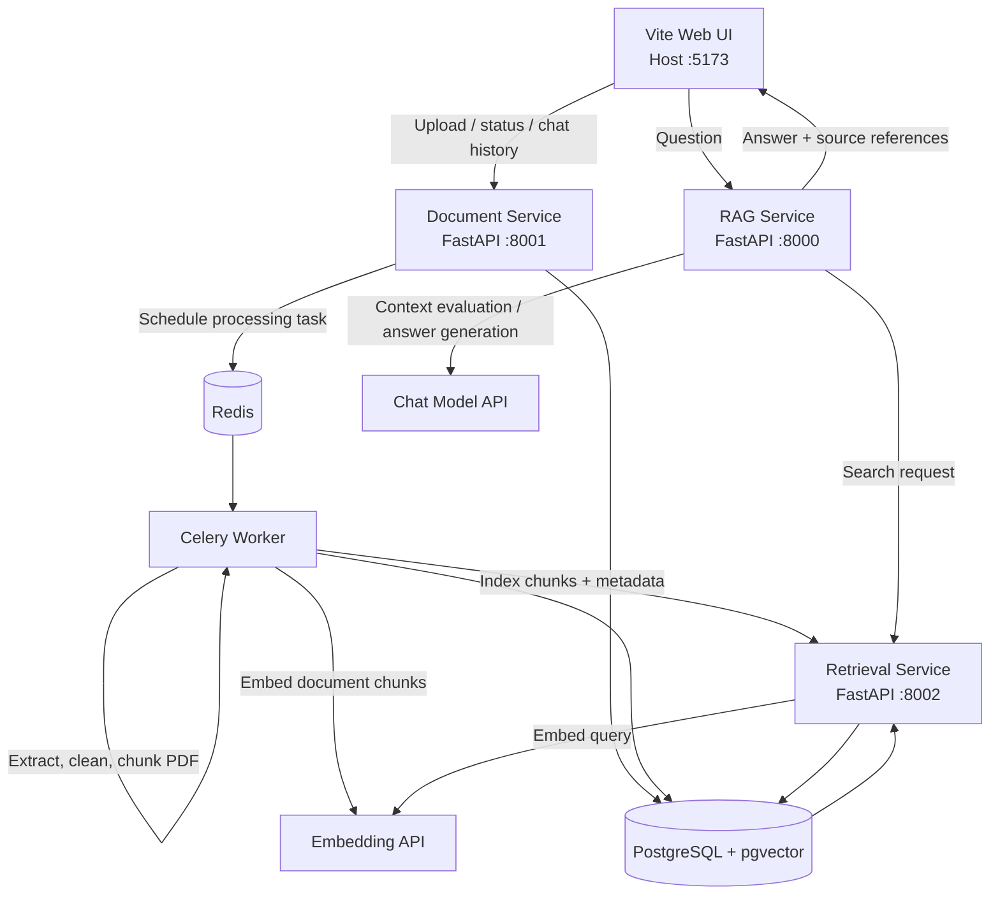
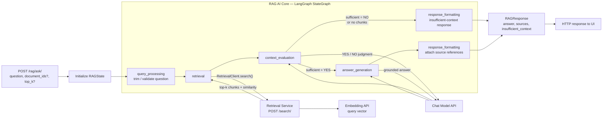

# Multi-Service Persian RAG System

A local, Dockerized Retrieval-Augmented Generation system for Persian PDF documents. The project separates document ingestion, vector indexing, and answer generation into three FastAPI services, with a host-run Vite frontend for interaction.

This repository is implemented as a development-oriented stack rather than a production deployment. It is designed to run locally with Docker Compose, PostgreSQL + pgvector, Redis, Celery, and external OpenAI-compatible embedding and chat providers.

## Architecture

| Component | Role | Local endpoint / access |
|---|---|---|
| `rag-service` | FastAPI entry point for questions; invokes the LangGraph RAG workflow | `http://127.0.0.1:8000` |
| `document-service` | PDF upload, metadata and chat-history management, and async processing coordination | `http://127.0.0.1:8001` |
| `retrieval-service` | Embeds query text, indexes chunks, and performs pgvector semantic search | `http://127.0.0.1:8002` |
| `celery-worker` | Asynchronous PDF extraction, cleaning, chunking, document embedding, and indexing | internal Docker network |
| `postgres` | PostgreSQL with pgvector; stores document metadata and chunk vectors | `127.0.0.1:5433` |
| `redis` | Celery broker and result backend | `127.0.0.1:6379` |
| `frontend` | Vite-based Persian web UI | `http://127.0.0.1:5173` |

### Service communication

Backend containers communicate over the Docker Compose network using service names rather than `localhost`:

- `rag-service` → `http://retrieval-service:8002`
- `document-service` / `celery-worker` → `http://retrieval-service:8002`
- `document-service` / `celery-worker` → `redis://redis:6379/0`
- `document-service`, `celery-worker`, and `retrieval-service` use PostgreSQL at `postgres:5432` for their respective metadata or vector data.

The published ports are bound to `127.0.0.1`, so the APIs and database are exposed on the local machine rather than on all network interfaces. The RAG service itself calls the retrieval service and the configured chat-model API; it does not connect directly to PostgreSQL.

### System architecture diagram



### RAG Agent and LangGraph AI core

The question-answering core is implemented in `services/rag_service/app/graph/graph.py` and `nodes.py`. The diagram below reflects the actual LangGraph `StateGraph`: nodes pass values through `RAGState`, and `context_evaluation` routes to answer generation only when the LLM judges the retrieved evidence sufficient.

> **Terminology:** the code implements an explicit LangGraph RAG workflow (sometimes called the RAG agent/core), not a free-form autonomous agent. It has a fixed set of nodes and conditional routing; it does not independently plan arbitrary actions or select from a general-purpose tool set.



The shared state is declared as `RAGState` in `services/rag_service/app/graph/state.py`. It carries the input question and filters, retrieved chunks and context, context-sufficiency result, answer, source references, and insufficient-context flag. The implementation uses two chat-model operations when chunks are available: one for context sufficiency evaluation and, if sufficient, another for answer generation. If no chunks are found, the graph bypasses LLM evaluation and formats the insufficient-context response.

## Real flow in this codebase

### 1) Document upload and ingestion

1. The frontend uploads a PDF to `POST /documents/upload/`.
2. The Document Service saves the original file under a document-specific storage directory.
3. The service records document metadata in PostgreSQL, creates a chat record, and schedules a Celery task through Redis.
4. The Celery worker runs `process_document_task`.
5. The worker validates the PDF, extracts text with PyMuPDF, normalizes Persian text, splits text into chunks with overlap, and requests document embeddings from the configured embedding endpoint.
6. It sends `IndexRequest` data to `POST /internal/index/` on the Retrieval Service.
7. Retrieval Service stores chunk vectors and metadata in PostgreSQL using pgvector.
8. The document status changes to `completed` or `failed` depending on processing outcome.

### 2) Retrieval and semantic search

The Retrieval Service exposes:

- `POST /search/` for vector search
- `GET /documents/{document_id}/chunks/` for retrieving chunks by document
- `POST /internal/index/` for indexing chunks
- `DELETE /internal/documents/{document_id}/chunks/` for deletion cleanup

For search, Retrieval Service creates an embedding for the query using the configured embedding API, then searches the `chunks` table with cosine distance and returns the top-k matches.

### 3) Question answering via LangGraph

The RAG Service exposes `POST /rag/ask/` with a question and optional `document_ids` and `top_k`. It invokes the LangGraph workflow shown above: query processing, retrieval, context evaluation, conditional answer generation, and response formatting. If evidence is insufficient, it returns the configured Persian insufficient-context response; otherwise it returns a grounded answer with source references.

## What is implemented in the repo

```text
.
├── Dockerfile
├── docker-compose.yml
├── README.md
├── .env.example
├── SQL/
│   └── DB.sql
├── frontend/
│   ├── index.html
│   ├── package.json
│   ├── src/
│   └── vite.config.js
├── scripts/
│   └── init_db.py
├── services/
│   ├── document_service/
│   │   ├── app/
│   │   └── requirements.txt
│   ├── rag_service/
│   │   ├── app/
│   │   └── requirements.txt
│   └── retrieval_service/
│       ├── app/
│       └── requirements.txt
├── shared/
│   └── schemas/
├── tests/
│   └── unit/
└── pytest.ini
```

## Stack and libraries

- Languages: Python, JavaScript (frontend), HTML/CSS
- Runtime: FastAPI, Celery, LangGraph, SQLAlchemy, PostgreSQL + pgvector, Vite
- Notable dependencies: `fastapi`, `sqlalchemy[asyncio]`, `pgvector`, `celery[redis]`, `langgraph`, `pymupdf`, `openai`, and `vite`

## Requirements

- Docker Desktop / Docker Engine with Docker Compose
- Python 3.12 for backend local debugging
- Node.js 20+ and npm for the frontend
- An OpenAI-compatible chat model endpoint
- A compatible embedding endpoint whose output dimension matches the configured vector schema

## Configuration

From the repository root, create `.env` if it does not already exist:

```powershell
if (-not (Test-Path .env)) { Copy-Item .env.example .env }
```

Set at least:

- `POSTGRES_PASSWORD`
- `LLM_API_BASE_URL`, `LLM_API_KEY`, `LLM_MODEL`
- `EMBEDDING_API_URL`, `EMBEDDING_DIMENSION`

The example values and defaults are defined in `.env.example`. The embedding endpoint and dimension must be compatible with the database vector schema.

## Run the backend

```powershell
docker compose up -d
docker compose ps
```

On the first run after changing Dockerfiles or dependencies, build the images first:

```powershell
docker compose build
docker compose up -d
```

Check logs:

```powershell
docker compose logs -f
```

Stop containers without deleting persistent data:

```powershell
docker compose down
```

Do not use `docker compose down -v` unless you intentionally want to delete named volumes and persisted data.

## Run the frontend

The frontend is a host-run Vite development server. In a separate terminal:

```powershell
cd frontend
npm install
npm run dev
```

Open the URL printed by Vite (normally `http://127.0.0.1:5173`). The Vite proxy forwards `/documents/*` to Document Service, `/rag/*` to RAG Service, and `/health/*` to the corresponding service health endpoint.

## API overview

Swagger UI:

- `http://127.0.0.1:8000/docs` — RAG Service
- `http://127.0.0.1:8001/docs` — Document Service
- `http://127.0.0.1:8002/docs` — Retrieval Service

### Document endpoints

| Method | Endpoint | Description |
|---|---|---|
| `POST` | `/documents/upload/` | Upload a PDF file |
| `GET` | `/documents/` | List documents |
| `GET` | `/documents/{document_id}/status/` | Get processing status |
| `GET` | `/documents/{document_id}/chat/` | Fetch chat history |
| `POST` | `/documents/{document_id}/chat/messages/` | Save a chat message |
| `DELETE` | `/documents/{document_id}/chat/` | Delete a document's chat history |
| `POST` | `/documents/{document_id}/reprocess/` | Requeue a document for processing |
| `DELETE` | `/documents/{document_id}/` | Delete document record, chat, and indexed chunks |

### Retrieval endpoints

| Method | Endpoint | Description |
|---|---|---|
| `POST` | `/internal/index/` | Internal chunk indexing endpoint |
| `POST` | `/search/` | Semantic vector search |
| `GET` | `/documents/{document_id}/chunks/` | Fetch chunks for a document |
| `DELETE` | `/internal/documents/{document_id}/chunks/` | Delete document chunks |

### RAG endpoints

| Method | Endpoint | Description |
|---|---|---|
| `POST` | `/rag/ask/` | Ask a question and receive an answer plus sources |
| `GET` | `/health/` | Health check |

## Operational checks

Check containers:

```powershell
docker compose ps
```

Check API health endpoints:

```powershell
Invoke-RestMethod http://localhost:8000/health/
Invoke-RestMethod http://localhost:8001/health/
Invoke-RestMethod http://localhost:8002/health/
```

Check Celery worker responsiveness:

```powershell
docker compose exec -T celery-worker celery -A services.document_service.app.tasks.celery_app.celery_app inspect ping
```

These checks confirm service health and worker reachability; they are not an end-to-end test of PDF upload, indexing, retrieval, and answer generation.

## Tests

Run unit tests from the repository root in a configured Python environment:

```powershell
python -m pytest tests/unit -v
```

Some tests may require external services or environment configuration depending on the test implementation.

## Important current-scope notes

- PDF processing is asynchronous; a successful upload means the job was accepted, not that indexing has finished.
- Ask questions only after the document status becomes `completed`.
- The Web UI is a lightweight development interface, not a production deployment.
- Authentication, authorization, rate limiting, production CORS policy, and deployment hardening are outside the current scope.
- External embedding and chat APIs must be available and correctly configured.
- PDFs without extractable text (such as scanned image-only PDFs without OCR) cannot be processed successfully by the current extractor.
- The LangGraph implementation is a fixed RAG workflow with conditional routing, not a general autonomous planning agent.
- Do not commit `.env`, API keys, or database credentials.
